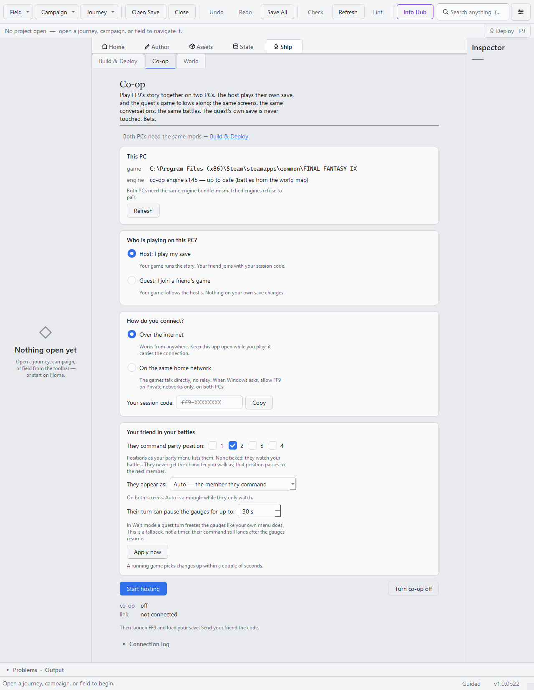

# 17 — Play FF9 together: co-op in the Workspace

```toml
[tutorial]
track = "D"
goal = "Set up two PCs so a friend can join your FF9 game: they follow your screens, conversations and battles, and command a party member you hand them."
requires = ["game", "gui", "engine-bundle"]
```

Co-op lets two people play the real FF9 story together. The **host** plays their own save as
normal. The **guest**'s game follows along: when the host changes screens the guest is pulled with
them, conversations play on both screens, and in battle the guest commands the party members the
host hands them, from FF9's own battle menu. The guest's own save is never touched.

Co-op is in **beta**. If something goes wrong, report it on
[GitHub](https://github.com/GameJawnsInc/Dream-World-IX/issues).

## 1. Set up both PCs (once)

Both players do this.

1. Own FINAL FANTASY IX on Steam or GOG, and install [Memoria](https://github.com/Albeoris/Memoria)
   the normal way. Memoria comes first: the next step patches it.
2. Download `DreamWorldIX-Setup.exe` from the
   [latest release](https://github.com/GameJawnsInc/Dream-World-IX/releases/latest) and run it.
   Tick **Install the Memoria engine patches**. Co-op needs them even though the option only
   mentions forked fields. The originals are backed up first.
3. Open **Dream World IX (Workspace)** from the Start menu and go to **Ship ▸ Co-op**.
4. Check the **This PC** card: `game` shows your FF9 folder and `engine` says up to date. If either
   row is amber, click **Open Setup & health…** and fix it there.

Both PCs must run the **same** engine version. Mismatched engines refuse to pair.

## 2. Host: start a session



1. Under **Who is playing on this PC?** choose **Host: I play my save** (①).
2. Under **How do you connect?** choose **Over the internet** (②).
3. Under **Your friend in your battles**, tick the party position your friend will command (③).
   Position 2 is a good start. Your friend never gets the character you walk as: if the story seats
   that character in their position, they get the next member instead. Set **They appear as** to
   **Auto** (④) so your friend looks like that party member on both screens.
4. Click **Start hosting** (⑤). The first time takes about a minute. Your session code is copied
   to the clipboard: send it to your friend. The code is your PC's own and stays the same each time
   you host. A code you once used to join a friend is never reused when you host.
5. Keep the Workspace open while you play (it carries the connection), then launch FF9 and load
   your save.

You can change the battle settings mid-session: change them and click **Apply now**.

## 3. Guest: join

1. On the **Co-op** tab choose **Guest: I join a friend's game** and **Over the internet**.
2. Paste the host's code into **Host's session code** and click **Join game**.
3. Keep the Workspace open, then launch FF9 and load any save. Once the two games pair, yours jumps
   to the host's screen.

While you're paired:

- You're pulled along whenever the host changes screens, and conversations play in step: the host's
  presses turn the pages and pick the choices.
- In the host's battles you command the party members they handed you, or watch if they handed you
  none.
- On the world map the host drives; you wait and rejoin at their next stop.
- There is no main menu and no saving. When the session ends, your game reloads your own autosave:
  the one it made of your own game the moment your partner came online, so you go back to that screen
  (from its entrance) with your progress up to then. If that autosave was skipped (the
  `AutoSaveOnlyAtMoogle` or `DisableAutoSave` option is on, or you were in the middle of a scene), it
  reloads your last own autosave instead.

## 4. Stop

Click **Turn co-op off** on both PCs. The game goes back to solo play.

## Same home network instead of the internet

If both PCs are on the same network, you can skip the relay.

- **Host:** choose **On the same home network**, then **Start hosting**.
- **Guest:** choose **On the same home network**, type the host's LAN IP into **Host's LAN IP**,
  then **Join game**. The host can find their IP by running `ipconfig` and reading the IPv4 Address.

When Windows asks about FF9 and the network, allow it on **Private** networks only, on both PCs.

## If it doesn't work

- **The engine row is amber:** one PC has an older engine. Run **Open Setup & health…** on it and
  install the engine patches from the same release as your friend.
- **The games never pair:** check that both PCs show the same code, and that neither side clicked
  **Turn co-op off**. The **Connection log** at the bottom of the tab shows what the link is doing.
- **Someone else got into your game, or the log says two hosts are on one code:** host with a fresh
  code. With the Workspace still open, run `ff9mapkit coop host --new-code --no-bridge` once in a
  terminal (`--no-bridge` keeps the Workspace's connection; without it a second one starts beside
  it). Then click **Start hosting** again: it keeps the new code and copies it. Send your friend
  the new code.
- **Command-line instead:** the tab runs `ff9mapkit coop host` and `ff9mapkit coop join <code>`
  underneath; `ff9mapkit coop -h` lists every option.
